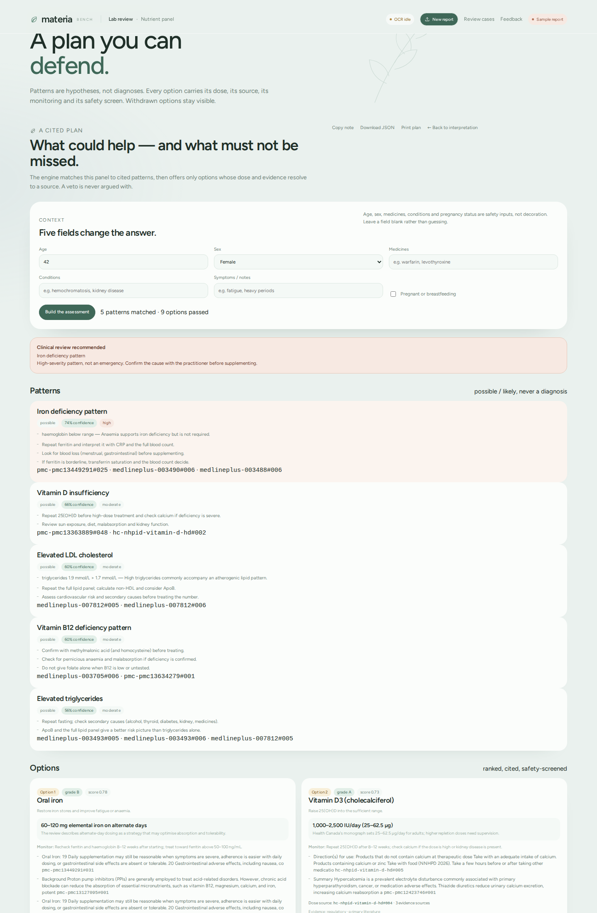

# materia

**1.0.0 local product.** A cited clinical decision-support engine for naturopathic and
integrative practitioners.
Blood tests in; cited patterns, supplement/herb options, safety screens and a grounded
conversation out.

It is **not** a replacement for a licensed practitioner. It does not issue a final diagnosis
or a prescription. Every option is a suggestion for a practitioner to accept, modify or reject.

The engine is deterministic. The optional chat layer runs on **CPU** with a 2B GGUF model;
no GPU, vLLM or cloud endpoint is required.



## What works now

- Read a digital lab PDF from its text layer (OCR only for pages with no text), extract rows,
  apply a plausibility gate and require human confirmation.
- Match findings against cited patterns: iron deficiency, B12 deficiency (including high MMA), folate deficiency,
  vitamin D insufficiency, low serum magnesium, liver enzyme elevation, elevated triglycerides,
  underactive thyroid, overactive thyroid, dysglycaemia, elevated LDL, low HDL, high homocysteine, amino-acid panel review, reduced eGFR, high uric acid, raised bilirubin, low albumin, low platelets, high platelets,
iron overload, high calcium, raised inflammation.
- Return ranked options with a dose range, a source chunk, monitoring and safety flags:
  oral iron, oral B12, folic acid, vitamin D3 + safe sun/diet advice, oral magnesium, milk thistle (grade C; evidence
  shown as conflicting), omega-3 for triglycerides, curcumin for LDL, berberine for dysglycaemia
  and zinc for low serum zinc (grade C; adjunct only). Lifestyle and referral steps (iron absorption,
  liver-cause investigation, diet/exercise, thyroid review, metabolic risk review, cardiovascular
  risk review, iron-overload review, high-calcium review, inflammation review, urgent triglyceride
  review) are dose-less and ranked explicitly.
- Withhold an option when a context veto or a citation/dose check fails, and show it as withheld.
- Flag medication context: PPIs with iron/B12/magnesium, thiazides with vitamin D, antiplatelets and
  anticoagulants with fish oil — each flag carries its source.
- Critical-value gate: potassium, glucose, sodium, calcium, haemoglobin, platelets, INR, bicarbonate and triglyceride extremes (newborn alternatives where the source provides them)
  withhold supplement/herb options and keep referral/lifestyle steps visible.
- Record a practitioner decision on each option (accept / modify / reject) to a local JSONL file;
  that is the label stream for calibrating the ranking. The completion screen shows the
  agree/unsafe/missing/skip counts and downloads the labels as JSONL. Each label carries the
  reviewer, engine version and a hash of the rule files, so it is tied to the rules that produced it.
- Ask grounded questions about the assessment. With no model configured, a deterministic
  responder answers from the assessment; “tell me more” returns the goal, dose, flags, monitoring
  and evidence. With a local open-weight model configured, it explains
  the same object and receives a bounded conversation history for follow-ups; an answer that
  introduces a dose or citation outside the assessment is rejected.
- Web app: `Lab review` → `What this means` → `Plan` (intake, patterns, options, withheld, gaps,
  sources, chat, accept/modify/reject, print) and a `Review cases` mode for clinician labelling.

## Quick start

```bash
python3 -m venv .venv
.venv/bin/pip install -e .
.venv/bin/python -m materia.cli doctor
.venv/bin/python -m materia.cli serve --port 8765 --open
```

The default sample is a **synthetic nutrient/lipid panel** and works with no model; it exercises
iron, B12, vitamin D and lipid patterns. The amino-acid sample is available as a coverage-gap demo.
Uploads need the OCR weights and `--start-ocr`.

CLI:

```bash
# blood test rows -> cited assessment
.venv/bin/python -m materia.cli recommend case.json

# ask about that assessment (deterministic; add a model endpoint to use one)
.venv/bin/python -m materia.cli chat case.json "What dose of iron, and what should I recheck?"
```

`case.json`:

```json
{
  "intake": {"age": 42, "sex": "female", "medications": [], "conditions": []},
  "rows": [
    {"analyte": "Ferritin", "value": 8, "unit": "ng/mL", "ref_low": 15, "ref_high": 150},
    {"analyte": "Haemoglobin", "value": 105, "unit": "g/L", "ref_low": 120, "ref_high": 160},
    {"analyte": "MCV", "value": 76, "unit": "fL", "ref_low": 80, "ref_high": 100}
  ]
}
```

## Optional chat model — CPU only

The recommendation engine is deterministic and needs no model. For a conversational layer,
serve a small open-weight instruct model with `llama.cpp` on CPU:

```bash
cd ~/bin/llamacpp/llama-b11936 && ./llama-server \
  -m ~/models/minicpm5/MiniCPM5-2B-Q4_K_M.gguf \
  -c 4096 -np 2 -t 4 --jinja --no-reasoning-preserve --port 8099

export MATERIA_CHAT_BASE_URL="http://127.0.0.1:8099/v1"
export MATERIA_CHAT_MODEL="minicpm5-2b-q4"
```

No GPU, no vLLM, no closed API. The engine works without a model; the model only explains an
assessment it is given. Q4 (1.5 GB) is the low-RAM baseline; Q8 (2.7 GB) is the higher-quality
CPU baseline. CPU runbook and measured results: [model-runbook.md](docs/model-runbook.md).

## Evidence and safety

- Regulatory monographs (Health Canada NNHPD, EMA), CC-BY primary literature (Europe PMC full
  text), public-domain compendia (MedlinePlus, NCCIH, NCI), and traditional-use claims, each
  shown with its tier.
- A dose must be a substring of the cited chunk. A rule whose citation does not resolve is
  withheld. Notes are lexically checked against their cited chunk.
- Safety: context vetoes (e.g. iron in haemochromatosis, vitamin D in hypercalcaemia, fish oil
  in fish allergy) run before ranking; flags (pregnancy, kidney disease, anticoagulants) stay
  visible.
- Patterns are labelled `possible` or `likely`, never a confirmed diagnosis.

## Tests and measurement

```bash
.venv/bin/python -m pytest -q
.venv/bin/python scripts/eval_recommend.py
.venv/bin/python scripts/review_report.py   # accept rate + unsafe/missing reasons (--json too)
.venv/bin/python scripts/make_review_packet.py   # printable 50-case clinician packet
.venv/bin/python scripts/review_cases.py --limit 5   # interactive agree/unsafe/missing labels
.venv/bin/python scripts/make_review_csv.py   # blank 50-row label sheet
.venv/bin/python scripts/import_reviews.py docs/review-labels.csv --dry-run   # import filled labels
.venv/bin/python scripts/audit_rules.py   # citations, doses, freshness, gaps
```

- 163 tests.
- CPU chat, single-turn, **29/29 = 100% [88.3, 100.0]**:
  - Q8: 27 model answers, 2 rejected.
  - Q4: 23 model answers, 1 deterministic answer, 5 rejected.
- CPU chat, multi-turn, **17/17 = 100% [81.6, 100.0]**:
  - Q8: 15 model answers, 2 rejected.
  - Q4: 12 model answers, 5 rejected.
- These are contract tests, not prose quality. Q4 is the low-RAM default; Q8 follows the
  citation contract more often. A 3B CPU model is optional; it must pass the same benchmark.
- 73 synthetic contract vignettes: **73/73 = 100% [95.0, 100.0]** for pattern match, top-option
  agreement, withheld options, safety flags, gaps and citation integrity. This is a self-authored
  contract set, not clinical validation. Recorded in `docs/scores.json`.

Validation status and the claim policy: [validation.md](docs/validation.md).
Licensing and medical-device scope: [NOTICE.md](NOTICE.md). Release history: [CHANGELOG.md](CHANGELOG.md).

## Layout

- `materia/clinical.py` — analyte catalog, unit conversion, findings, pattern matching.
- `materia/recommend.py` — evidence graph, dose/citation validation, safety, ranking.
- `materia/chat.py` — grounded conversational layer.
- `materia/rules/` — analytes, patterns, recommendations, red flags, safety.
- `materia/webapp/` — local web app.
- `corpus/` — 401 licence-clear documents, 5,207 chunks.
- `docs/clinical-engine.md` — design, scoring equation, evaluation plan.
